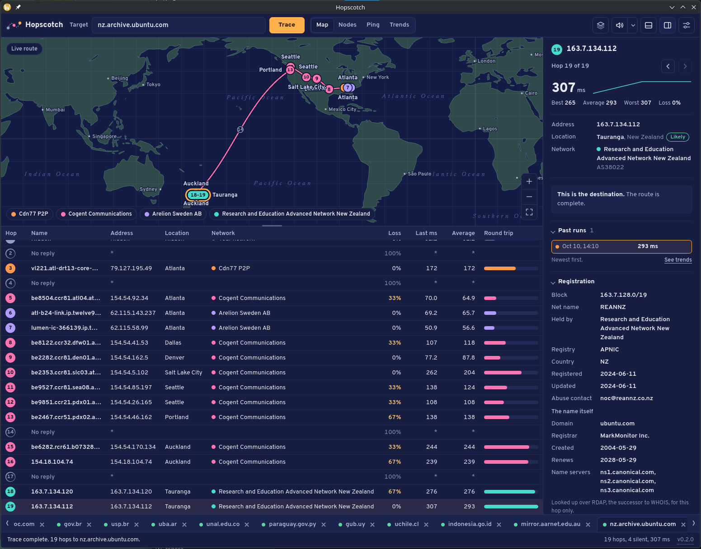
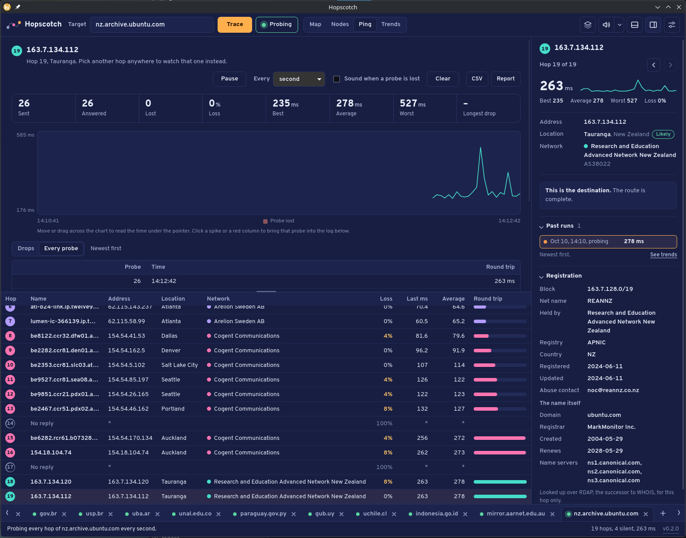
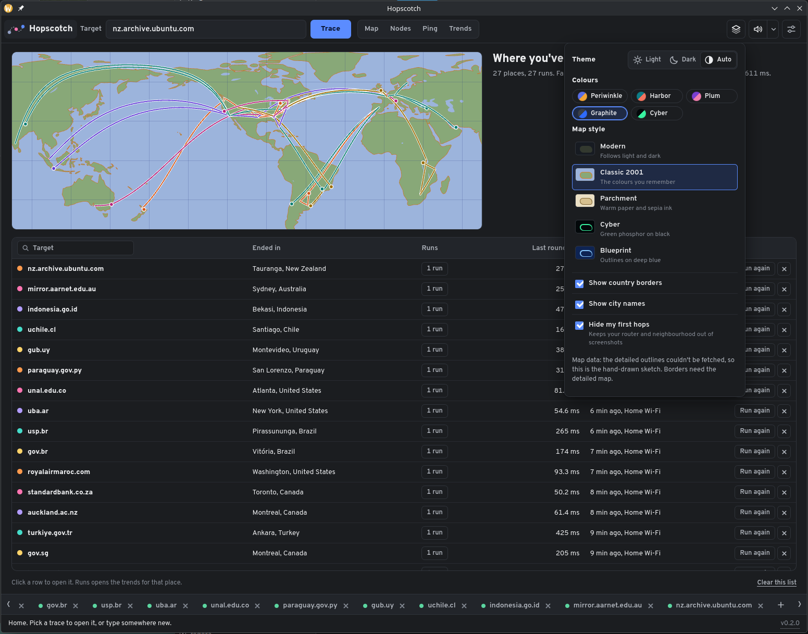
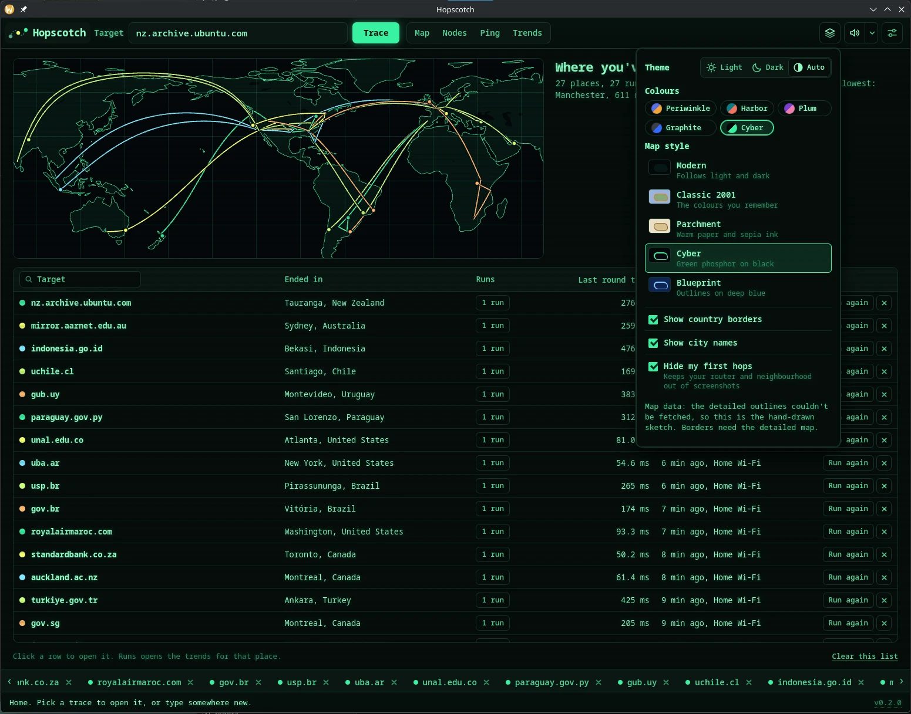
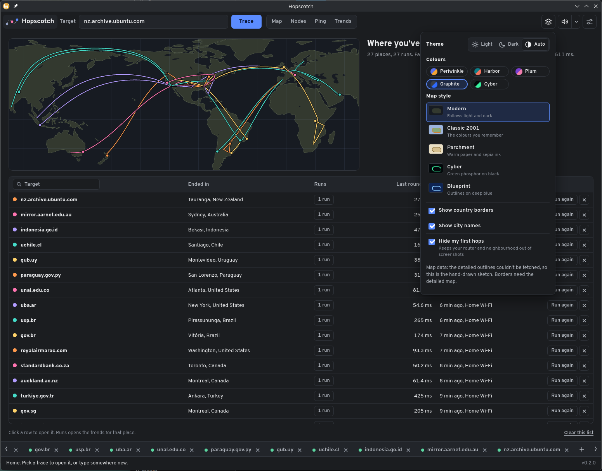

# Hopscotch

A visual traceroute for the desktop, in the spirit of the classic NeoTrace: the route your packets take, drawn hop by hop on a real world map, with continuous probing so you can watch drops as they happen and trends across every run you've saved.

> Status: **0.2, pre-release.** On Linux the app sends its own probes; Windows and macOS run the system traceroute tool. Tested daily on Fedora; the Windows and macOS builds need real-world testing before it is ready for other people. See *Testing* below.

## Screenshots

A live trace from Denver to a mirror in New Zealand. The map draws the route hop by hop; the table below it keeps the names, places, networks and round trips; the pane on the right has the registration record for the hop you pick.



Keep probing: every hop pinged once a second, charted for the hop you choose, with a log of every probe and drop.



Home remembers where you've been, in whichever skin and map style you like: the Classic 2001 colours, green phosphor Cyber, or the modern dark map.







## What it does

- **Trace** any host name or address. Hops appear as they answer, on the map and in the table, with a chirp per hop (three sound packs, or silence), played by the app through the system audio output.
- **Real world map** with five styles (Modern, Classic 2001, Parchment, Cyber, Blueprint), five colour skins, light and dark themes.
- **Details** for every hop: name, address, place, network and AS number, the leg from the previous hop, and the registration record over RDAP (the successor to WHOIS), looked up only for the hop you pick.
- **Keep probing**: every hop pinged on an interval you choose; the Ping view charts one hop over time with a cursor you can drag across, a log of drops, and CSV or printable reports.
- **Trends**: every finished trace is saved per target; compare any two runs hop by hop, chart the round trip over time, export the lot.
- **Home**: everything you've traced, searchable and sortable, with all routes on one map.
- **Privacy**: addresses reserved for private networks (your router, your ISP's carrier-grade NAT) never leave your machine. "Hide my first hops" keeps them out of screenshots.

Nothing phones home. The only outside services used are the geolocation lookup (ip-api.com, for public addresses only) and RDAP registries via rdap.org, both on demand.

## Downloads

Every push to `main` builds all three platforms in GitHub Actions; tagged releases attach them to a Release. Portable builds, no installer needed:

| Platform | File | Notes |
| --- | --- | --- |
| Windows 10/11 | `Hopscotch-portable-windows-x64.exe` | Needs the WebView2 runtime, which Windows ships. An NSIS installer is built too. |
| macOS 10.15+ | `Hopscotch-macos-universal.app.zip` | Not notarized yet: the first time, right-click the app and choose Open. |
| Linux | `Hopscotch-linux-x86_64.AppImage` | `chmod +x` and run. Needs `traceroute` or `tracepath` installed (see below). A `.deb` is built too. The AppImage bundles WebKitGTK and GStreamer but leaves Wayland, X11 and Mesa to the host, so it runs on current Fedora and Ubuntu alike. |

## How it traces

On Linux, Hopscotch sends its own probes and needs no extra rights: UDP datagrams with a rising TTL, reading the ICMP answers off the socket the way unprivileged `traceroute` does. When a destination drops UDP (many web servers do), a TCP handshake on port 443 shows whether it is up and how many hops away it is, so the trace ends at the host instead of trailing off into silence. Continuous probing uses ICMP echo over a datagram socket where the system allows it (`net.ipv4.ping_group_range`, open on most distributions) and the `ping` tool otherwise. Settings has a switch back to the system traceroute.

Windows and macOS still run the tools that ship with the OS, which already have the rights they need:

| OS | Tool | Needs |
| --- | --- | --- |
| Windows | `tracert -d` | nothing; it uses the Windows ICMP API |
| macOS | `/usr/sbin/traceroute -n` | nothing; it is setuid root |
| Linux (fallback) | `traceroute -n` (or `tracepath -n`) | the `traceroute` package or `iputils` for tracepath |

Hops stream in as they answer. Native probing for the other two platforms is next; see [BACKEND.md](BACKEND.md).

## Building

Prerequisites: [Rust](https://rustup.rs) (stable), Node 18+, and the [Tauri 2 prerequisites](https://v2.tauri.app/start/prerequisites/) for your OS (on Linux: `libwebkit2gtk-4.1-dev libappindicator3-dev librsvg2-dev patchelf`).

```sh
npm install          # the Tauri CLI
npm run dev          # run the app with live reload
npm run build        # bundles under target/release/bundle/
npm run test:core    # Rust unit tests (parsers, RDAP, geolocation shaping)
```

The UI is a single page, `ui/index.html`, that also runs in a plain browser as a **demo** with simulated routes (open the file directly). Inside the app, `ui/live.js` connects it to the Rust backend and the simulator steps aside.

## Testing

The UI tests run headless with Playwright: `node tests/smoke.js` (demo mode) and `node tests/live.js` (live mode against `tests/fake-tauri.js`, a stand-in backend that answers the same commands and emits the same events as `src-tauri`). The Rust parsers have unit tests against real `tracert`, `traceroute` and `tracepath` output.

What still needs a human and a real network, in order of risk:

1. **Windows**: `tracert` output parsing on a localized Windows (times are printed as `12 ms`; the code sets the C locale, but `tracert` ignores it), the portable `.exe` starting without a console window, WebView2 present.
2. **macOS**: Gatekeeper's warning on the unsigned app; `traceroute` streaming (it flushes per probe, so hops should appear one at a time); Wi-Fi name via `ipconfig getsummary en0`.
3. **Linux**: `traceroute` present vs absent (the app says which package to install); AppImage on Wayland; Wi-Fi via `nmcli`.
4. Geolocation rate limits when tracing many targets quickly (ip-api.com allows 45 requests a minute; each trace is one batch).

## Layout

```
ui/            the app page (index.html), the live bridge (live.js), favicon
core/          hopscotch-core: traceroute runner and parsers, ping, geo, RDAP, DNS, network info
src-tauri/     the desktop shell: Tauri commands and events over the core crate
tests/         Playwright smoke tests and the fake backend
tools/         the patch that folded live mode into the demo page (history)
.github/       the three-platform build
```

## Name and credit

NeoTrace was a McAfee product; this is an homage, not a fork or a clone, and shares no code with it. "Hopscotch" is a working name. Map outlines come from the open-source [Datamaps](https://datamaps.github.io/) project (fetched at runtime; a hand-drawn sketch is used offline). Geolocation by [ip-api.com](https://ip-api.com) (free tier, non-commercial). Registration data via [rdap.org](https://rdap.org).

## License

MIT. See [LICENSE](LICENSE).
