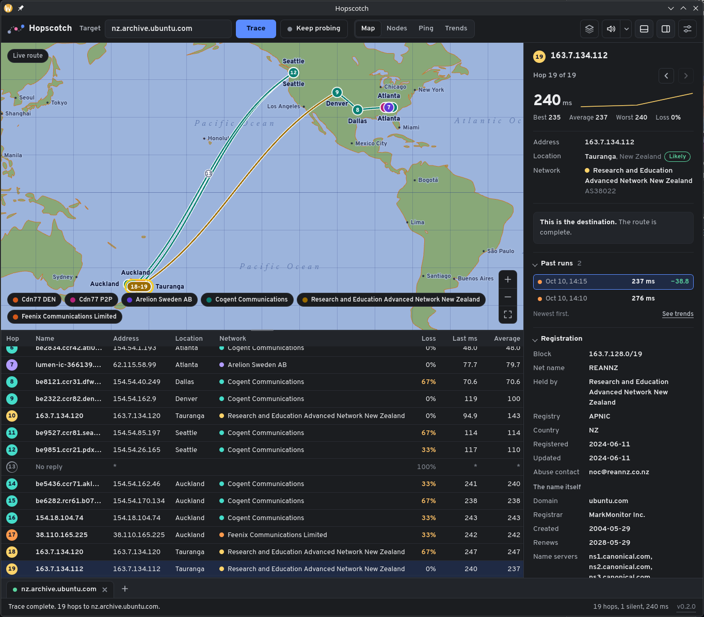
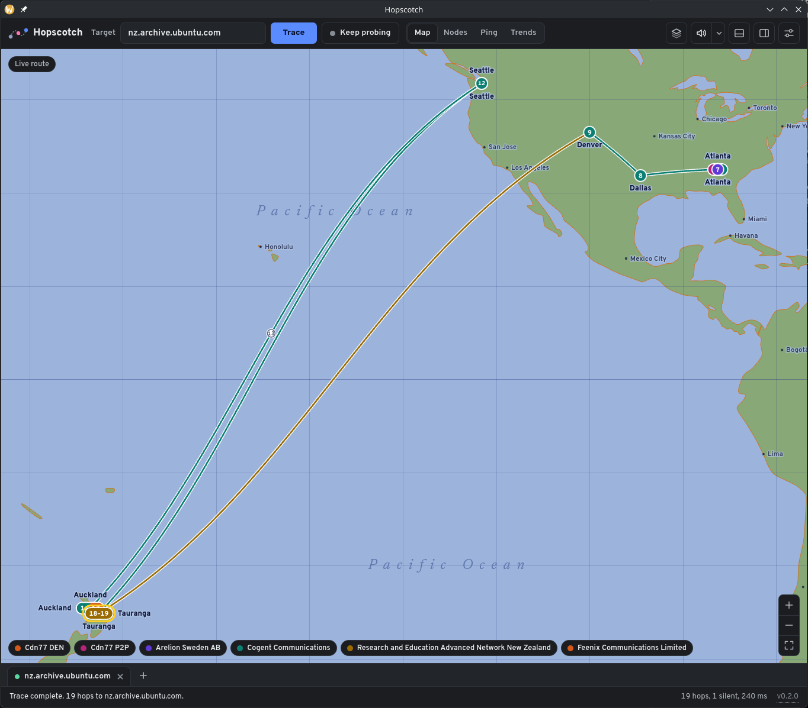
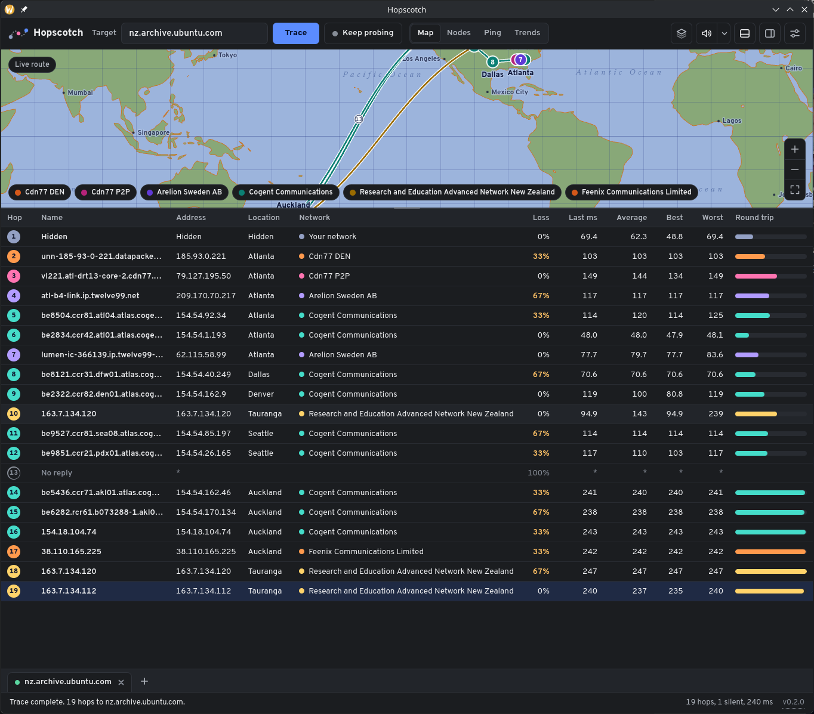
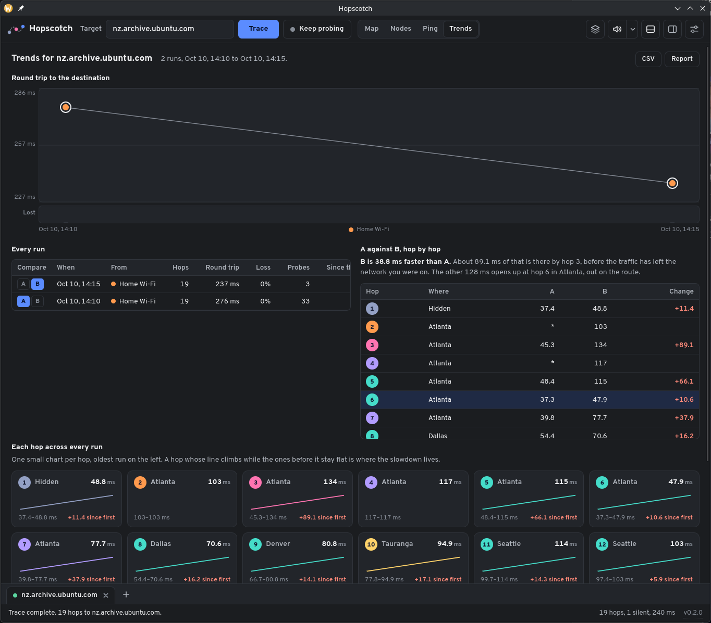

## Tracing

A live trace across the Pacific, drawn as it arrives. The table keeps names, places, networks and round trips; the pane on the right holds the registration record for the hop you pick.

The same route in the Classic 2001 map style.

Zoomed to the ocean crossing. Hop 13 never answered, so it sits halfway along the cable it must have crossed.

The full table under a wide map.

## Probing and trends

Keep probing pings every hop once a second. The Ping view charts the hop you choose and logs every probe and every drop.

Trends compares any two saved runs hop by hop and says where the time went.

## Home, in three styles

